# SahneCAD — sahne, ses, ışık, elektrik ve kablo planlama

Etkinlik sahnesini **2D plan + 3D + bağlantı şeması** olarak çiz. Hoparlörden mikrofona, davuldan
moving head'e kadar her şeyi yerleştir. Kabloları port port bağla. Program her kablonun tipini ve
boyunu, elektrik yükünü ve ses dağılımını hesaplar. Sonunda sahneyi hiç bilmeyen birinin kurabileceği
**adım adım kurulum talimatını** (Türkçe / Almanca / İngilizce) çıkarır.

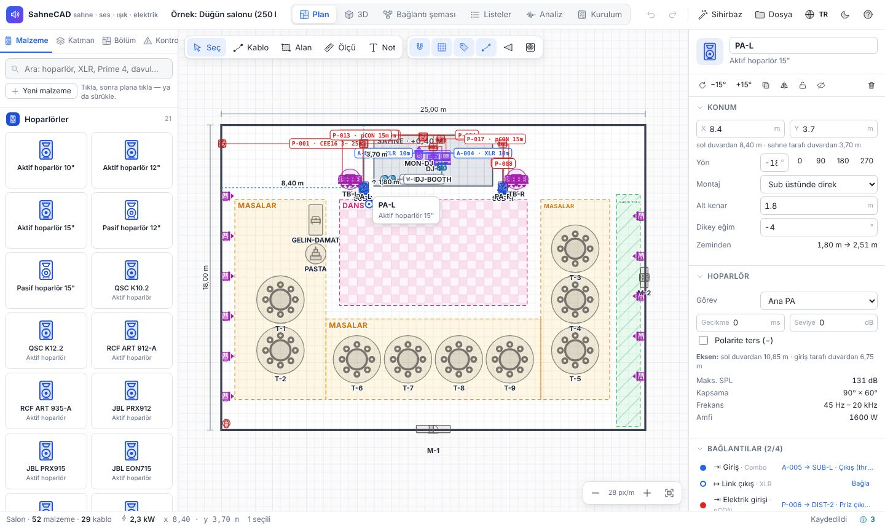

## Hemen kullan

- **`SahneCAD.html` dosyasına çift tıkla.** İnternet gerekmez. Chrome, Edge veya Safari'de açılır.
- Projeler tarayıcıda otomatik saklanır. Başka bir bilgisayara taşımak için
  **Dosya → Proje dosyası indir (.json)**, diğer bilgisayarda **Proje dosyası aç**.
- İlk açılışta hazır bir örnek gelir: 250 kişilik düğün salonu (DJ, kablosuz mikrofon, ışık, elektrik).
  **Sihirbaz** ile kendi etkinliğini saniyeler içinde kurabilirsin.

## iPhone'da kullan (UMIK-1 ile)

Adres: **https://emraync.github.io/dj-analiz/#olcum**

1. iPhone'da Safari ile aç → **Paylaş** → **Ana Ekrana Ekle**. Simgeden açınca tam ekran çalışır.
2. Bir kez açıldıktan sonra **internetsiz de** açılır (salonda internet olmasa da).
3. Diğer ekranlar aynı adreste: `#plan`, `#3d`, `#sema`, `#listeler`, `#analiz`, `#kurulum`.

UMIK-1'i bağlama:

- **USB-C iPhone** (15 ve sonrası): UMIK-1'in USB kablosunu USB-C'ye çeviren kabloyla doğrudan tak.
- **Lightning iPhone**: *Lightning – USB 3 Kamera Adaptörü* ile tak.
- Denetim Merkezi → **Mikrofon Modu: Standart** seç (Ses Yalıtımı ölçümü bozar).

Adres herkese açıktır ama içinde senin bilgin yoktur. Projelerin sadece telefonunda saklanır.

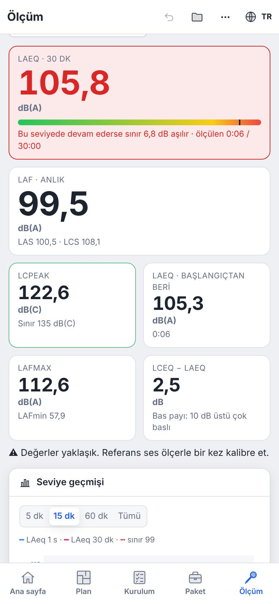

## Neler var?

| Ekran | Ne işe yarar |
|---|---|
| **Plan** | Ölçekli kuşbakışı çizim. Salon, sahne podesti, dans pisti, masalar, kaçış yolları. Duvarlara mesafeler, kablo etiketleri (Cisco gibi: `A-012 · XLR 10m`), hoparlör kapsama alanı, **ses basıncı ısı haritası**. Mekan krokisi resim olarak altına konabilir. |
| **3D** | Her cihazın 3D modeli: hoparlör standları, line array açıları, sub, monitör, Prime 4, mikser, davul seti, moving head, truss, masa ve sandalyeler. Kamera: genel / üstten / salondan / sahneden / FOH. 3D'de taşı, yükselt, döndür. |
| **Bağlantı şeması** | Sinyal akışı blok şeması: cihazlar portlarıyla, kablolar etiketiyle. **Porttan porta sürükleyerek bağla.** Elektrik şeması (faz, watt, amper). Tüm bölümler birlikte gösterilebilir. |
| **Listeler** | Malzeme listesi (standlar, ara direk, kum torbası, podest, kablo köprüsü, gaffa otomatik eklenir), kablo listesi, **kablo paketi** (hangi boydan kaç kablo + yedek), **input listesi**, elektrik devreleri. CSV (Excel) ve yazdırma. |
| **Analiz** | Ortalama/maksimum dB, dağılım, oda yankısı (RT60), kritik mesafe, delay önerileri, sıcaklığa göre ses hızı, rüzgar ve komşu ses sınırı, faz yükleri, öneriler. |
| **Ölçüm** | **miniDSP UMIK-1** (USB, iPhone dahil) veya **Behringer ECM8000** (ses kartı) ile: **dB ölçer** (LAeq, LAF, LCpeak, geçmiş, isteğe bağlı yasal sınır, protokol), **RTA**, **gecikme ölçümü** (sub–tepe, ana–delay, yankı süresi), **EQ önerisi** (hangi frekansı ne kadar indireceğin) ve geri besleme avcısı. |
| **Kurulum** | Kurulumu yapacak kişi için **akış diyagramı** (ekip şeritleri, kritik yol), **zaman çizelgesi** (etkinlik saatine göre en geç başlangıç) ve adım adım talimat. Her adım işaretlenebilir. Başka dilde yazdırılabilir. |

### Ses dağılımı: pist yüksek, masalar konforlu

**Analiz** ekranının başındaki bölüm:

- Her bölgenin **hedef seviyesi** var: dans pisti 98 dB, masalar 87 dB, seyirci 96 dB, bar 82 dB.
  Tablodan ya da bölgenin ayarlarından değiştirilir.
- Program yankıyı da hesaba katar (salonun malzemesi, kişi sayısı). **Netlik** sütunu masalarda konuşmanın ve
  şarkı sözünün anlaşılır olup olmadığını gösterir.
- **Öneriler**: alan uzadıkça gereken **delay hoparlörleri**, sahne yanındaki masalar için **yan dolgu**,
  **pist hoparlörleri** ve ana hoparlörlerin açısı. Her öneride konum, yükseklik, **gecikme (ms)** ve
  seviye var. "Planda göster" ile yeşil kesikli görürsün; "Uygula" ile kablolarıyla eklenir (geri alınabilir).
- **Seviye ayarı**: ana sistem, delay ve sub için mikserde ne kadar kısıp açacağın.
- **Mesafe profili**: sahneden uzaklaştıkça her bölgenin seviyesi, şimdi ve önerilerle.
- **Pistin sahneye uzaklığı**: pistin her konumu denenir, önerilen aralık gösterilir, tek tuşla taşınır.
- Planda ısı haritasını **"Hedefe göre"** aç: yeşil uygun, mavi az, kırmızı fazla.

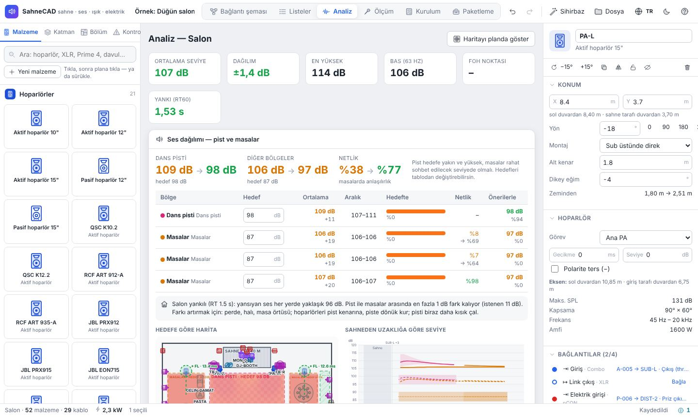

### dB ölçer ve yasal sınır

**Ölçüm → dB ölçer** sekmesi gerçek bir ses seviyesi ölçer gibi çalışır:

- **LAeq** (sınır penceresine göre kayan ortalama, örn. 30 dk), **LAF / LAS** (anlık), **LCpeak**, **LAFmax**,
  başlangıçtan beri LAeq ve bas payı (LCeq − LAeq).
- Seviye geçmişi grafiği (5 / 15 / 60 dk / tümü) ve **protokol (CSV)**: saniye saniye kayıt, belgelemek için.
- **Ses sınırı isteğe bağlıdır**: aç/kapat. Hazır ayarlar: **DIN 15905-5** (Almanya, 99 dB(A) / 30 dk,
  LCpeak 135 dB(C)), **WHO 2022** önerisi (100 dB(A) / 15 dk) ya da kendi değerin. Sınır projeye kaydedilir.
- Pist hedefi sınırın üstündeyse ses dağılımı bölümü de uyarır.
- "Ekranı açık tut" ile telefon ölçüm sırasında kararmaz.

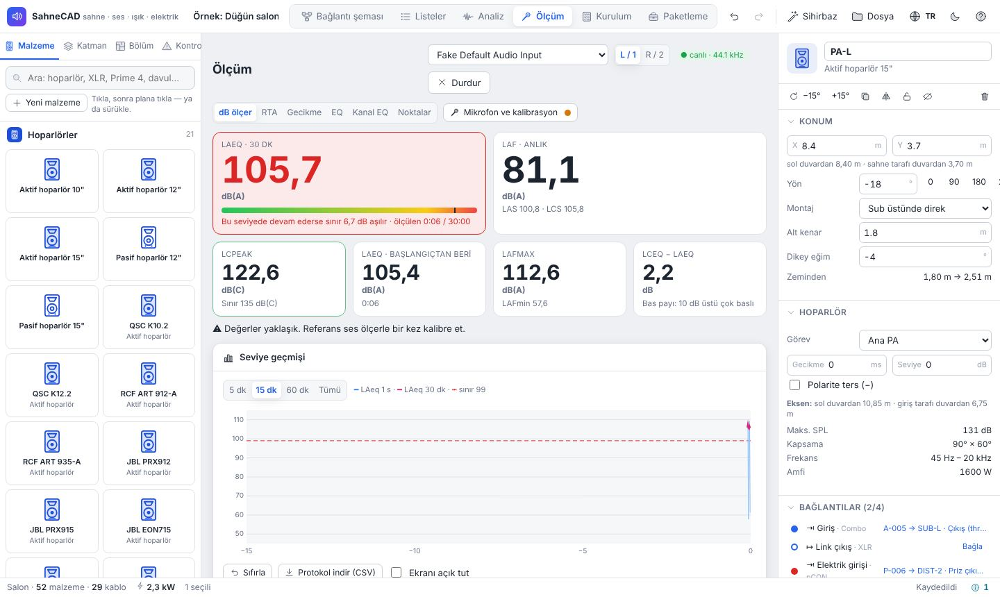

### Gecikme ölçümü: sub–tepe ve ana–delay

**Ölçüm → Gecikme** sekmesi tarama sinyaliyle (sweep) hoparlörlerin mikrofona varış zamanını ölçer.

- **Sub – tepe (satellite) hizalama**: mikrofonu pistin ortasına koy. Mikserde önce **sadece sub**,
  sonra **sadece tepe** açıkken "Ölç"e bas. Program hangi tarafa kaç ms gecikme gerektiğini ve gerekirse
  sub polaritesinin çevrilmesini söyler. Geçiş bölgesinde kazanılan bas da yazılır. "Plana yaz" ile
  hoparlörün gecikmesi güncellenir.
- **Ana – delay hizalama**: mikrofonu delay hoparlörünün kapsadığı bölgenin başına koy. Sadece ana, sonra sadece
  delay ölç. Program delay hoparlörüne eklenecek gecikmeyi verir; sesin sahneden geliyormuş gibi
  duyulması için küçük bir ek pay (Haas, 5–10 ms) ekler.
- **Tek ölçüm, birden çok varış**: ana ve delay birlikte açıkken iki varış arasındaki fark da görülür.
- **Yankı süresi**: her ölçümden salonun gerçek yankı süresi (T20/T30, 125 Hz – 4 kHz) hesaplanır ve
  modelle karşılaştırılır.
- **Sıfır noktası**: mikrofonu hoparlöre dayayıp bir kez ölçersen cihazın kendi gecikmesi çıkarılır ve
  hoparlörlere uzaklık metre olarak görünür.

Test sinyali iki yoldan çalınabilir:

- **Bu cihazdan çal**: bilgisayarın veya telefonun ses çıkışı miksere bağlıysa. Ayrı ayrı (A/B)
  ölçümler sadece bu yolla karşılaştırılır (zaman referansı bilinir). Bluetooth kullanma.
- **Başka cihazdan (WAV)**: "Tarama WAV" dosyasını indir, DJ cihazından (örn. Prime 4 USB) çal.
  Telefon sadece dinler. Bu modda aynı ölçümdeki varışlar karşılaştırılır. "Pembe gürültü WAV" de
  RTA ve EQ için aynı şekilde kullanılır.

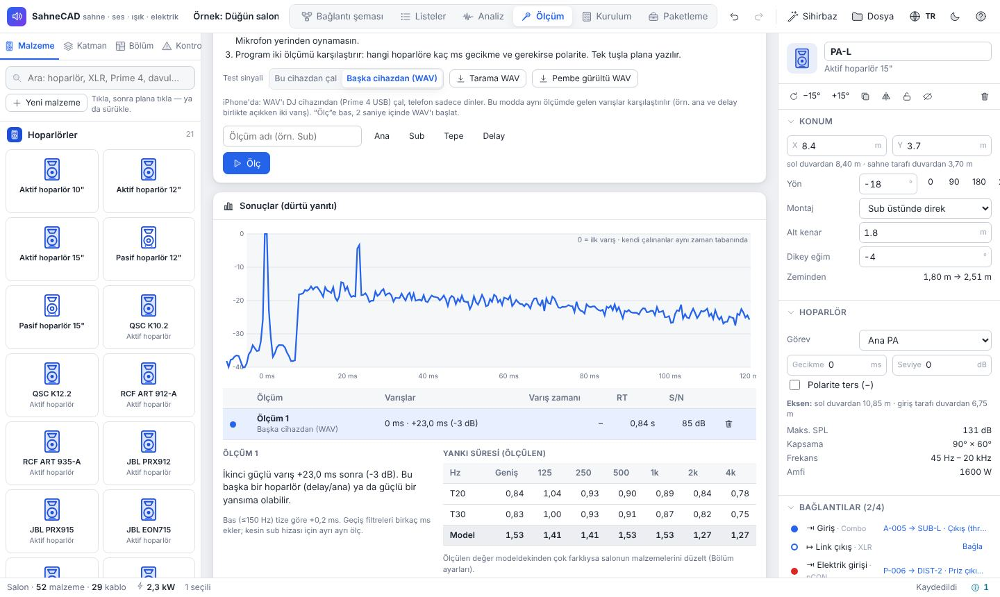

### Ölçüm: UMIK-1 / ECM8000 ile canlı RTA

1. **UMIK-1**: USB'ye tak. miniDSP sitesinden seri numarana ait kalibrasyon dosyasını indir ve
   "Kalibrasyon dosyası" ile yükle. **ECM8000**: ses kartının XLR girişine tak, 48V phantom aç,
   kazancı ayarla ve sonra değiştirme.
2. **Ölçüm** sekmesi → "Ölçümü başlat" → tarayıcıda mikrofon iznini ver (Chrome veya Edge önerilir).
3. Bir kez **kalibre et**: pembe gürültü çalarken referans ses ölçerin değerini yaz. 94 dB
   kalibratörün varsa 94 / C seç. Kalibre edilmeden seviyeler yaklaşıktır, EQ önerisi yine çalışır.
4. Pistte ve masalarda birkaç noktada ölç. Planda mikrofonun yerine tıkla ve "Ölçümü kaydet"e bas.
   En az 3 noktanın ortalamasıyla EQ yap, tek noktaya göre yapma.
5. **EQ önerileri**: hedef eğri seçilir (Dans, Salon, Canlı, Konuşma, Düz). Program frekans, kesme (dB)
   ve Q listesini verir; 31 bant grafik EQ değerlerini de gösterir. Varsayılan olarak sadece kesme
   (indirme) önerir. Sub ve tiz için kısa tavsiyeler verir.
6. **Geri besleme avcısı**: mikrofonlar açıkken çınlayan frekansları yakalar ve dar kesme önerir.

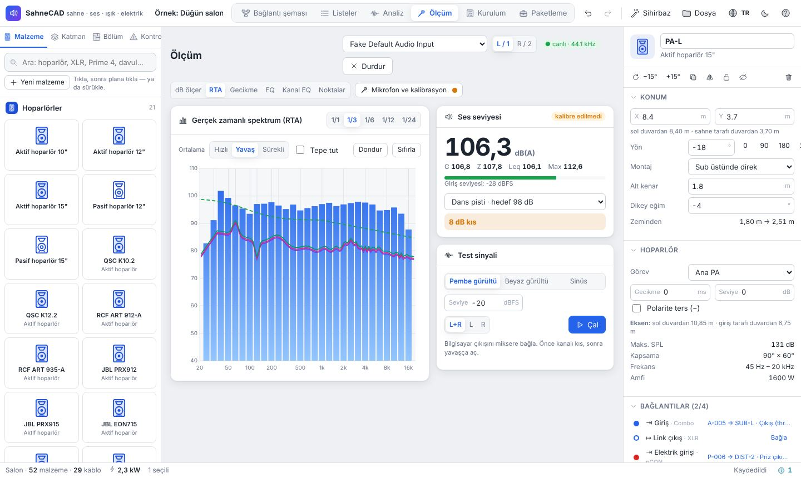

Ölçümler proje dosyasında saklanır ve planda mor noktalarla görünür. CSV olarak da indirilebilir.

### Kurulum: akış diyagramı ve zaman çizelgesi

Kurulum talimatı proje yönetimindeki gibi gösterilir:

- **Akış diyagramı**: ekip şeritleri (genel, sahne, rigging, elektrik, ses, ışık), hangi işin hangisinden
  sonra geldiği ve kırmızı **kritik yol**.
- **Zaman çizelgesi (Gantt)**: her işin süresi ve esnek payı. Proje bilgilerine etkinlik saatini yazarsan
  **en geç başlama saatini** hesaplar.
- Kutuya tıklayınca o işin adım adım talimatına gider. Yazdırınca diyagram da kağıda çıkar.

| | |
|---|---|
| 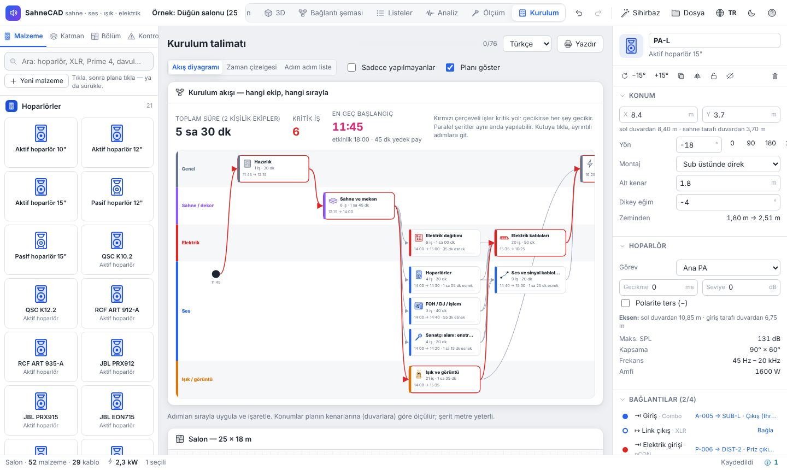 | 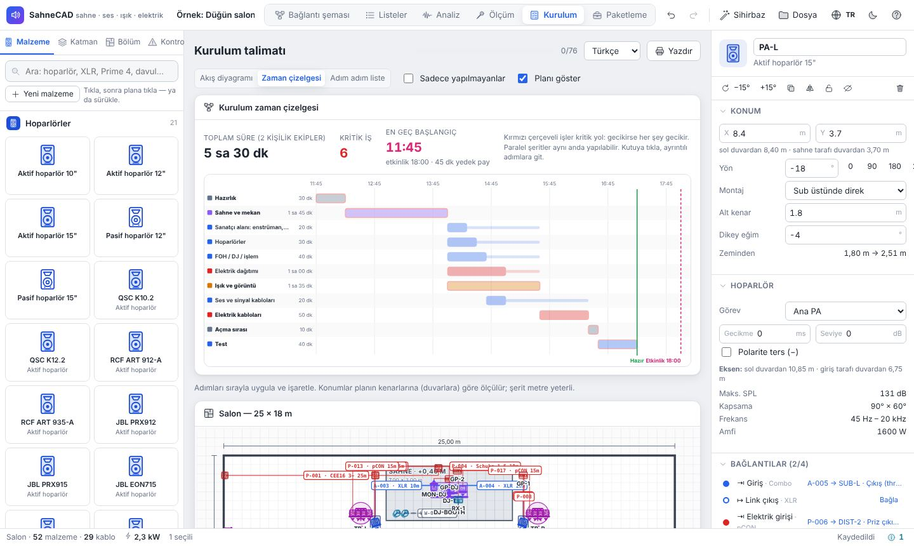 |

Diğer özellikler:

- **150'ye yakın malzeme**: aktif/pasif hoparlör, sub, line array (QSC, RCF, JBL, EV, Yamaha, dB, HK,
  d&b, L-Acoustics), monitör, IEM, mikserler (X32, Wing, SQ-6, Qu-16, TF5, DM3, Ui24R, analog),
  stagebox, amfi, DSP, DI, DJ (Denon Prime 4, SC6000, X1850, Pioneer CDJ-3000, DJM-900NXS2/A9, XDJ-XZ,
  Technics), mikrofonlar (kablolu ve kablosuz), **enstrümanlar** (davul seti, davul, zurna, klarnet,
  bağlama, ud, kanun, keman, kemençe, darbuka, def, tulum, org, piyano, gitar/bas ve amfileri),
  ışık (moving head, PAR, uplight, strob, hazer, soğuk kıvılcım, yer bulutu), truss/motor, LED ekran,
  projeksiyon, elektrik (Schuko, CEE 16/32/63 A, jeneratör, dağıtıcılar, grup priz, PRCD, UPS),
  ağ, sahne/dekor (podest, gelin–damat koltuğu, pasta masası, çiçek kemeri, yuvarlak masa) ve mekan
  (sütun, kapı, acil çıkış).
- **Kendi malzemen**: "Yeni malzeme" veya bir modeli "Özelleştir" ile ölçü, güç, hoparlör verisi ve
  portlarını düzenle. **İstediğin cihaza kendi resmini yükle**; ikon yerine planda, şemada, 3D'de ve
  talimatta görünür. Kendi malzemelerin "Kütüphanem"de tüm projelerde kalır.
- **Kablo tipleri**: XLR, TRS, TS, RCA, 3,5 mm, multikor, speakON (2,5/4 mm², NL8), AES/EBU, Cat6/etherCON,
  fiber, DMX 3/5 pin, HDMI, SDI, USB, MIDI, Schuko, powerCON, TRUE1, IEC, CEE 16/32/63, Powerlock, kablosuz.
  Konnektör uyumu, yanlış tip (örn. mikrofon kablosu ile DMX), çıkış→çıkış hataları denetlenir.
- **Otomatik kablolama**: sinyali (mikrofon → alıcı → mikser → sub → tepe, stagebox, monitörler) ve
  elektriği (en yakın boş priz, uzaktaki cihaza otomatik grup priz, fazları dengeleme, devre kapasitesi)
  tek tıkla bağlar; sonra elle düzeltirsin.
- **Kontroller**: aşırı yük, faz dengesizliği, gerilim düşümü, hoparlör hattı kaybı, kaçış yolundan
  geçen kablo (kablo köprüsü), geri besleme riski (mikrofon hoparlör önünde), seyirci içinde alçak
  hoparlör, power alley, yankı, sis makinesi/yangın alarmı, rüzgar, yağmur, komşu ses sınırı…
- **Bölümler**: salon, bahçe, kına odası gibi ayrı çizimler. Bölümler arası kablolar ve **hazırlık
  noktaları** ("bağlantı noktası", "harici sistem") ile başka bir ekip / bölüm / sonraki program için
  hazırlık yapılır.
- **Ekibe göre görünüm**: Ses ekibi, elektrikçi, ışıkçı, görüntü… Her biri sadece kendi kablolarını görür.
- **Kurulumcu modu**: Dosya menüsünden kilitli, salt okunur mod. Kurulumu yapacak kişiye ver.
- **Dışa aktarma**: AutoCAD (DXF), SVG, PNG, 3D PNG, CSV, proje dosyası (JSON), yazdırma.
- **Dil**: Türkçe, Deutsch, English. Açık ve koyu tema. Telefonda da açılır.
- Geri al / yinele, kopyala / yapıştır (başka bölüme de), ayna kopya (sol↔sağ), kilitle, gizle.

| | |
|---|---|
| 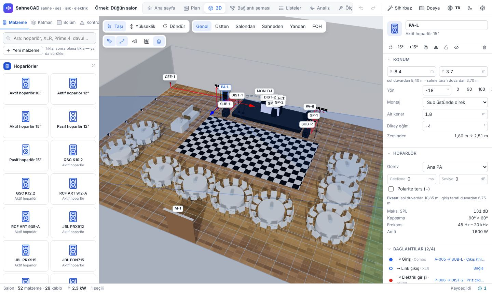 | 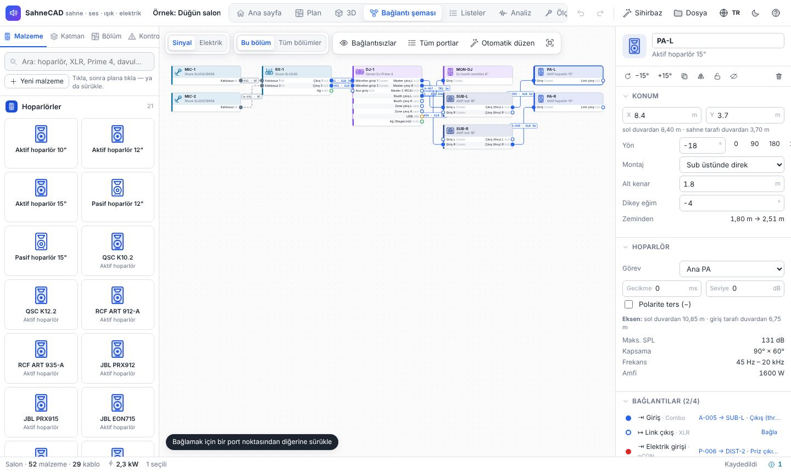 |
| 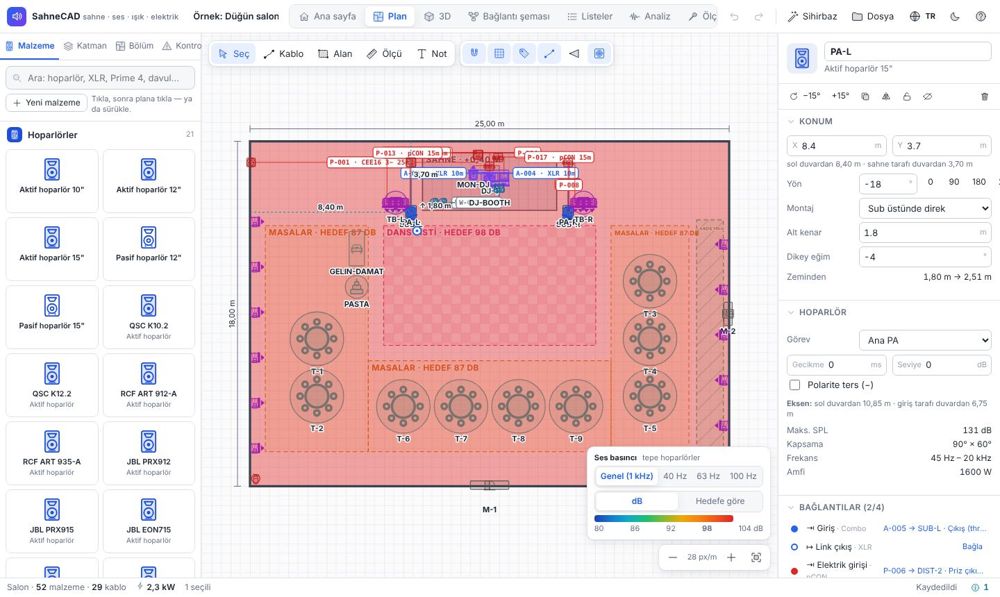 | 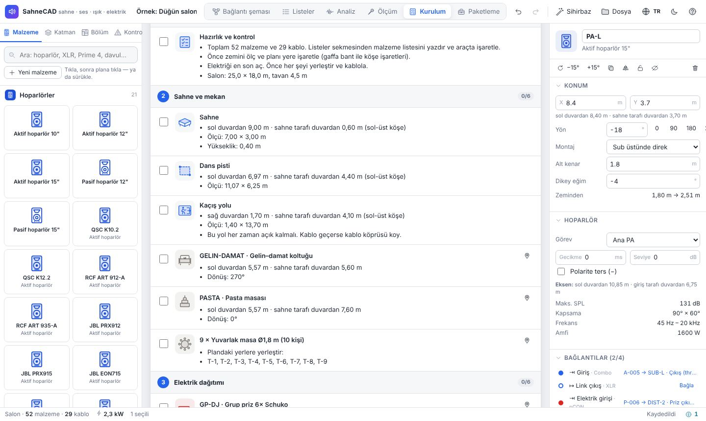 |
| 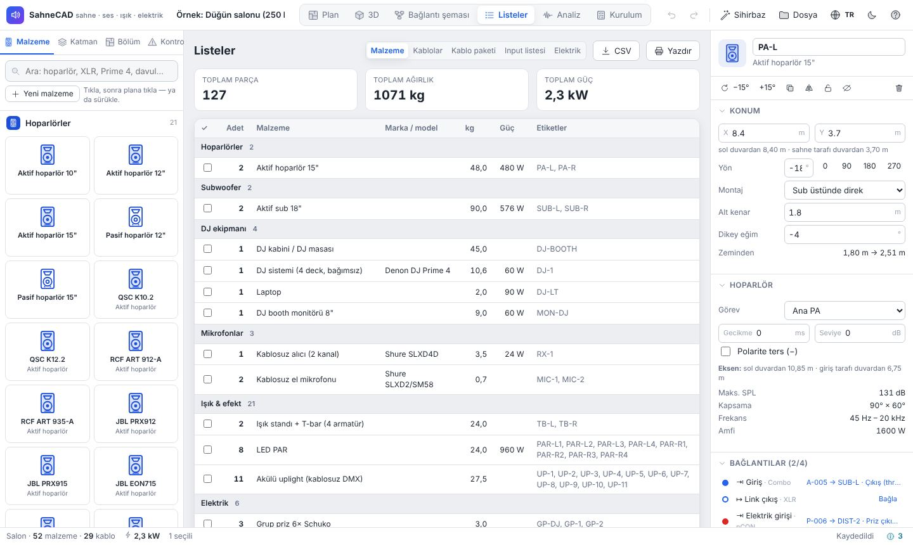 | 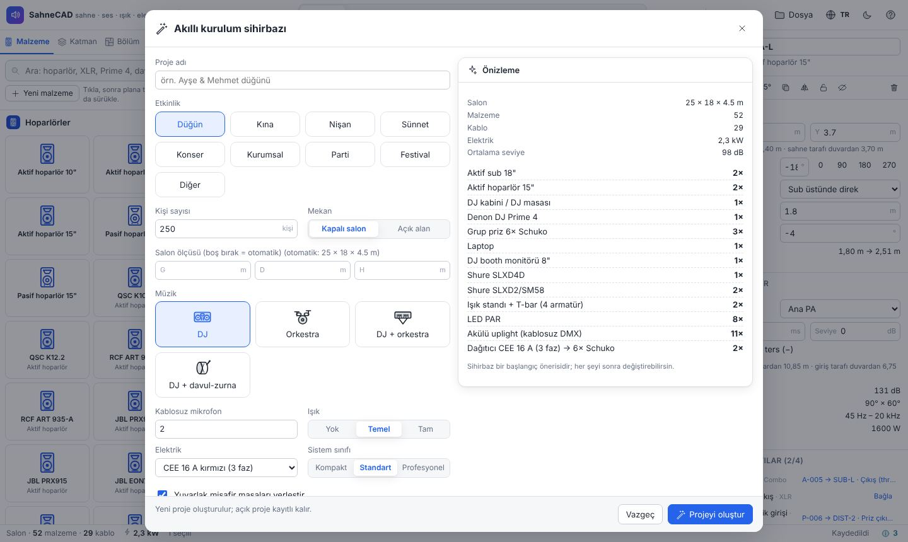 |
| 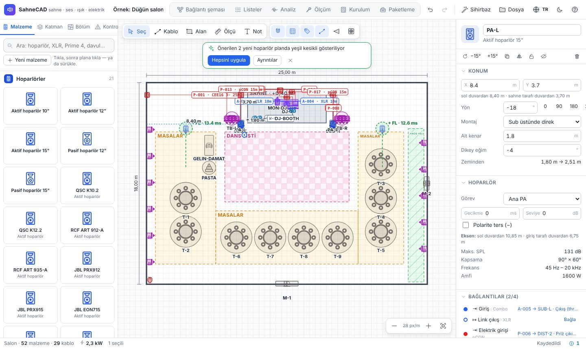 | 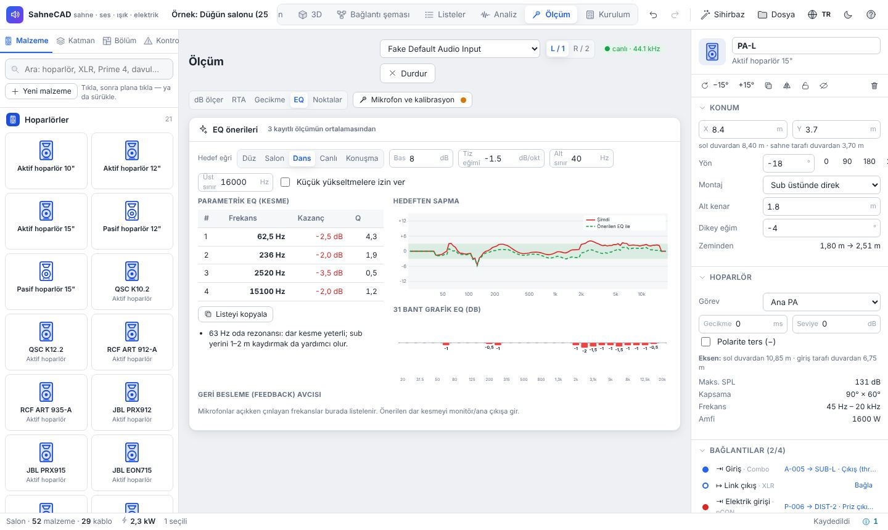 |

## Önemli

- Akustik ve elektrik değerleri **tahminidir**. Yankı istatistiksel modelle hesaplanır, tek tek yansımalar
  hesaplanmaz. Gerçek değeri ölçüm sekmesiyle kontrol et. Marka/model verileri
  yaklaşıktır; gerekirse "Özelleştir" ile üretici föyüne göre düzelt.
- 400 V / CEE bağlantılarını **elektrik yetkilisi**, asma (rigging) işlerini **yetkili rigger** yapmalı.
- Ses seviyesi: Almanya'da DIN 15905-5'e göre seyirci alanında 30 dakikalık ortalama 99 dB(A)'yı
  geçmemeli. Pist hedefi bu yüzden varsayılan 98 dB. Ölçüm ekranı Leq 99'u geçince uyarır.

## Geliştirme

```bash
npm install
npm run dev          # http://localhost:5180
npm test             # hesap motoru testleri
npm run build        # dist/ (çok dosyalı)
npm run release      # SahneCAD.html (tek dosya, çift tıkla aç)
npx vite preview --port 4173 &   # sonra:
npm run test:ui      # Playwright ile tıklama testleri
```

Teknoloji: React 18 + TypeScript + Vite, Three.js (react-three-fiber), zustand + immer.
Ayrıntılar ve mimari: [CLAUDE.md](CLAUDE.md).
